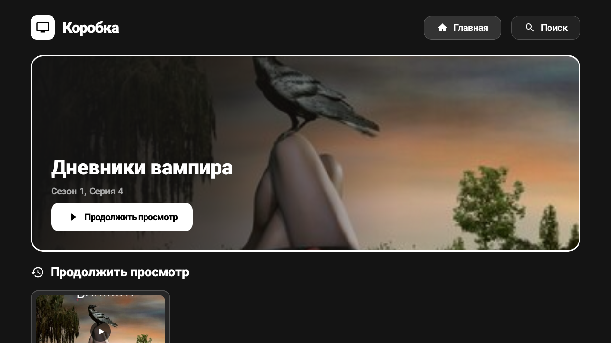
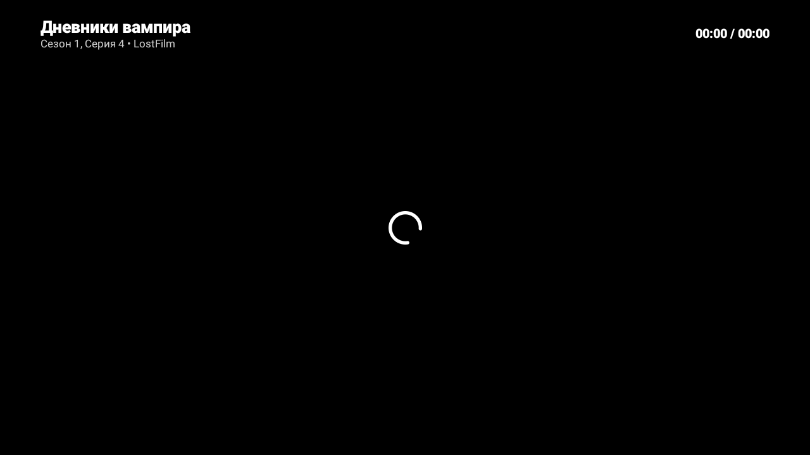

# Коробка TV (Box-TV)

Нативное Android TV приложение для комфортного просмотра фильмов и сериалов. Разработано с нуля на **Jetpack Compose for TV** и **Media3 ExoPlayer** без использования WebView, оптимизировано под управление стандартным пультом D-Pad и просмотр на проекторах.

---

## 📺 Скриншоты с устройства Android TV

| Главный экран (Hero + Продолжить просмотр) | Поиск и экранная клавиатура |
|:---:|:---:|
|  |  |

---

## ✨ Особенности

- **100% Native Kotlin & Jetpack Compose**: молниеносный UI без тормозов WebView и лагов рендеринга на ТВ-приставках.
- **ExoPlayer Media3**:
  - Адаптивное HLS воспроизведение.
  - Мгновенное бесшовное переключение аудиодорожек и студий озвучки (LostFilm, Кубик в Кубе, Дубляж и др.) прямо во время воспроизведения без сброса позиции.
  - Выбор качества потока (1080p FHD, 720p HD, 480p SD).
  - Удобный таймлайн перемотки с шагом 10 секунд и отображением буфера.
- **Автоматический переход к следующей серии**:
  - По окончании серии всплывает диалоговое окно «Перейти к следующей серии?».
  - Нажатие `OK` сразу запускает следующую серию (с автоматическим переходом на следующий сезон, если сезон подошел к концу).
- **Навигация сезонов без ложных срабатываний**:
  - Пролистывание сезонов в нижнем меню не сбрасывает и не перезапускает текущую серию; видео переключается только при явном клике по нужной серии.
- **Оптимизация под проекторы и ТВ**:
  - Высококонтрастный строгий темный UI (`#0F0F0F`).
  - Аккуратное, четкое выделение фокуса активного элемента (инверсия в белый цвет + тонкая окантовка 1.5dp) без дергания и искажения масштаба (`scale`).
- **Поиск**:
  - Интегрированная нативная D-Pad клавиатура.
  - Поиск по каталогу через открытые API без блокировок и лимитов 429.
- **История просмотров и Избранное**:
  - Автоматическое сохранение позиции воспроизведения, сезона, серии и выбранной звуковой дорожки каждые несколько секунд.

---

## 🛠 Сборка и установка

### Требования
- JDK 17+
- Android SDK (API 34–36, Build-Tools)
- Устройство Android TV / Google TV с включенной отладкой по ADB

### Сборка релизного APK
```bash
./gradlew assembleRelease
```

### Подпись и установка через ADB
```bash
# Подпись APK (например, через debug keystore)
apksigner sign --ks ~/.android/debug.keystore \
  --ks-pass pass:android \
  --key-pass pass:android \
  app/build/outputs/apk/release/app-release-unsigned.apk

# Установка на приставку по Wi-Fi
adb connect <IP_АДРЕС_ТВ>:5555
adb -s <IP_АДРЕС_ТВ>:5555 install -r app/build/outputs/apk/release/app-release-unsigned.apk
```

---

## 🏗 Архитектура

```
app/src/main/java/com/korobka/tv/
├── MainActivity.kt               # Точка входа Leanback launcher
├── ui/
│   └── MainTvScreen.kt           # Главный экран Compose TV (Hero, ряды, табы, поиск)
├── player/
│   └── NativePlayerActivity.kt   # Полноэкранный ExoPlayer, меню аудио/серий/качества, D-Pad
├── engine/
│   └── CdnEngine.kt              # Сетевой слой парсинга потоков и HLS мастер-манифестов
└── data/
    ├── Models.kt                 # Модели данных (MediaItem, Episode, Season, StreamSource)
    └── AppStorage.kt             # Локальное хранилище истории и избранного (SharedPreferences)
```
